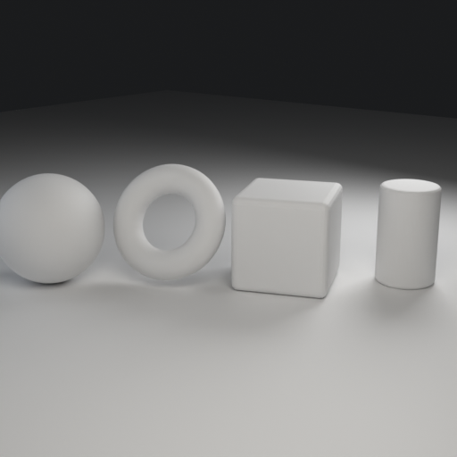
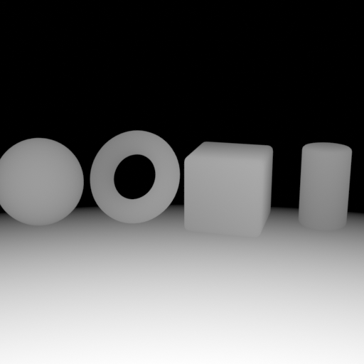
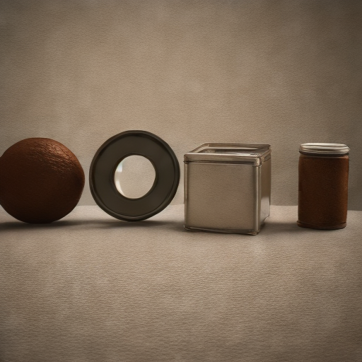

# 白膜转写实：纯 CPU 深度控制生成流水线

把 Blender 白模（clay）渲染成写实图：Blender 无头渲染导出 **depth / normal / clay** 三张图，
再用 **stable-diffusion.cpp（GGUF Q4_0 + SD2.1 depth ControlNet）** 在**纯 CPU** 上生成写实图，
最后附带一条**头像融合**（预乘 alpha + Poisson 融合 + 低强度 img2img 光色统一）的拓展链路。

> 实验七（大模型通识）配套代码仓。所有耗时数据由 `results/*.json` 自动汇总，报告中的表格与图由脚本生成，不手抄。

---

## 1. 效果一览

| 白模 clay | 深度控制图 depth | 写实结果 photoreal |
|---|---|---|
|  |  |  |

法线图（仅用于检查面朝向，不参与控制）：`docs/figures/normal.png`

---

## 2. 目录结构

```
clay2real-depth-pipeline/
├── blender/
│   ├── make_demo_scene.py          # 生成演示白模场景（球 / 圆环 / 倒角立方体 / 圆柱）
│   └── export_control_maps.py      # 无头导出 depth / normal / clay
├── scripts/
│   ├── run_pipeline.py             # 一键流水线：Blender 导出 → sd-cli 生成
│   ├── compose_head.py             # 拓展项：把正面头像融合进生成的人物图
│   ├── analyze_runs.py             # 汇总 results/*.json：耗时表 + 几何一致性指标 + 曲线
│   ├── fetch_assets.py             # 下载 sd.cpp CPU 后端与两个 GGUF 权重
│   └── run_all.ps1                 # 一键跑完 A~E 五组参数
├── assets/demo_white_model.blend   # 白模场景文件（由 make_demo_scene.py 生成）
├── models/                         # 主模型 + ControlNet（不入库，用 fetch_assets.py 拉取）
├── vendor/sdcpp-ext/               # sd-cli.exe 与 ggml / stable-diffusion 动态库（不入库）
├── output/                         # 全部中间图与最终结果（日志在 output/logs/）
├── results/                        # 每次运行的参数 + 耗时 JSON，以及 summary.md / metrics.json
├── docs/figures/                   # 报告用图
└── tests/                          # 不依赖模型/Blender 的单元测试
```

---

## 3. 环境

| 项目 | 本次实测配置 |
|---|---|
| CPU / 内存 | Intel Core Ultra 9 185H（16 核 22 线程）/ 40 GB（纯 CPU，无 GPU 参与） |
| 操作系统 | Windows 11 Pro 10.0.26200 |
| Blender | 4.5.13 LTS（`blender -b` 无头 + Cycles CPU） |
| 推理后端 | stable-diffusion.cpp `master-1017-be48649`（win-cpu-x64 预编译） |
| 主模型 | `sd_turbo-q4_0.gguf`（1.72 GB，q4_0） |
| ControlNet | `control_depth_sd21-fp16.gguf`（695 MB，SD2.1 depth，fp16） |

关键前提：**SD-Turbo 是 SD2.1 架构（交叉注意力 1024 维）**，必须配 SD2.1 的 depth ControlNet；
混用 SD1.5 的 768 维 ControlNet 会在加载时报 `got [768,1280] expected [1024,1280]`。

---

## 4. 快速开始

```powershell
# 0) 依赖
pip install -r requirements.txt
set BLENDER_EXE=D:\tools\blender-4.5.13-windows-x64\blender.exe

# 1) 拉取权重与推理后端（约 2.4GB；国内可加 --proxy 或 --endpoint https://hf-mirror.com）
python scripts/fetch_assets.py

# 2) 生成白模场景
python blender/make_demo_scene.py --out assets/demo_white_model.blend --res 512

# 3) 导出控制图（也可以直接跑第 4 步，流水线会自动调用）
blender -b assets/demo_white_model.blend -P blender/export_control_maps.py -- `
    --outdir output --name demo --res 512 --samples 64

# 4) 纯 CPU 生成写实图
python scripts/run_pipeline.py --name test512 --res 512 --steps 4 --cfg 1.2

# 5) 五组参数全跑 + 汇总（A 基准 / B 768² / C 8 步 / D CN 0.5 / E CFG 2.5）
powershell -NoProfile -File scripts/run_all.ps1

# 6) 汇总表 + 曲线
python scripts/analyze_runs.py
```

`run_pipeline.py` 的完整参数与实验指南一致：

| 参数 | 默认值 | 说明 |
|---|---|---|
| `--res` | 512 | 输出分辨率，512 或 768 |
| `--steps` | 4 | 采样步数（Turbo 模型 4~8） |
| `--cfg` | 1.2 | CFG 强度（Turbo 模型保持 1.0~1.5） |
| `--control-strength` | 0.9 | ControlNet 强度，1.0 表示完全覆盖初始信息 |
| `--seed` | 42 | 随机种子，固定可复现 |
| `--threads` | -1 | -1 表示占满所有核心 |
| `--control-image` | 无 | 跳过 Blender，直接复用已有深度图（绝对路径） |
| `--init-image` / `--strength` | 无 / 0.75 | img2img（拓展项的光色统一） |

默认提示词：

- 正向：`photorealistic render, studio soft lighting, PBR material, preserve original 3d geometry, sharp`
- 负向：`deformed geometry, perspective changed`

---

## 5. 实现要点

1. **深度图不是直接存 Mist**：Blender 的 Mist 是“近黑远白”，ControlNet 需要“近白远黑”，
   所以先按公式 `d = 1 - mist` 反相再落盘。
2. **mist 起止距离要用分位数**：只统计顶点时，地面（一个 4 顶点大平面）会被视锥排除，
   近端被抬到 7.6 m，画面下方出现大片被截断的死白。本项目改成
   **近端 = 可见表面射线采样的 2% 分位 + 远端 = 非地面物体顶点的 98% 分位**，
   地面与物体都能拿到连续灰度，同时不让地平线把动态范围拉爆。
3. **一次渲染出三张图**：compositor 里 `RLayers.Mist → Invert → OutputFile(depth)`、
   `RLayers.Normal → ×0.5+0.5 → OutputFile(normal)`，`RLayers.Image → Composite` 落成 clay 参考图，
   Blender 段因此只需约 10 s。
4. **control image 必须先转 RGB**：sd.cpp 的 control image 需要 ≥3 通道，单通道灰度会
   `control image load failed`，`run_pipeline.py` 用 Pillow 兜底转换。
5. **预乘 alpha 贴头像**：白底像素如果直接缩放，边缘会被插值成亮边；先 `rgb*alpha` 再缩放，
   合成分解后再除以 alpha，才能得到干净的边缘。

---

## 6. 结果

本次实测（Intel Core Ultra 9 185H，纯 CPU）：

| 运行 | 分辨率 | 步数 | CFG | CN | 采样(s) | 单步(s) | VAE(s) | 总耗时(s) | 白模边缘≤4px 覆盖率 |
|---|---|---|---|---|---|---|---|---|---|
| A | 512² | 4 | 1.2 | 0.9 | 66.1 | 16.5 | 18.0 | 98.2 | 98.3% |
| B | 768² | 4 | 1.2 | 0.9 | 122.6 | 30.6 | 56.5 | 205.4 | 89.6% |
| C | 512² | 8 | 1.2 | 0.9 | 97.7 | 12.2 | 16.1 | 129.0 | 93.2% |
| D | 512² | 4 | 1.2 | 0.5 | 57.4 | 14.3 | 15.1 | 86.8 | 92.9% |
| E | 512² | 4 | 2.5 | 0.9 | 50.4 | 12.6 | 25.0 | 88.3 | 92.5% |
| F | 512² | 4 | 5.0 | 0.9 | 62.3 | 15.6 | 15.5 | 90.8 | 69.9% |

- 汇总表：`results/summary.md`（由 `analyze_runs.py` 生成）
- 机读指标：`results/metrics.json`
- 缩放曲线：`docs/figures/timing_scaling.png`
- 几何一致性：`docs/figures/geometry_scores.png`

耗时经验公式（本次六组拟合约 53 s/Mpx）：

```
单步耗时 ≈ 53 s/Mpx × 像素数 × (1±0.2)      # 512² ≈ 12~17 s/步、768² ≈ 31 s/步
总耗时   ≈ 单步耗时 × 步数 + VAE 解码 + 3~9 s 的 Blender 段
```

结论：几何能保住（覆盖率 98.3%），材质会漂移（球变陶罐）；
CN 0.5 会丢拓扑（圆环通孔被封死），CFG≥2.5 会过饱和、CFG 5.0 连几何一起糊掉。

---

## 7. 拓展项：头像融合

```powershell
# 1) 生成“滑冰姿态人形”底图（预设 figure）
python blender/make_demo_scene.py --preset figure --out assets/figure_white_model.blend --res 512
python scripts/run_pipeline.py --name headfig --res 512 --steps 4 --cfg 1.2 `
    --blend assets/figure_white_model.blend

# 1.5) 没有个人照片时，用模型生成一张白底正面照当 --head（白底正好配合软抠图）
python scripts/make_head_photo.py --out assets/portrait.png

# 2) 几何合成（深度图定位头框 → 预乘 alpha 贴图 → 接触阴影 → Poisson 融合 → 颗粒匹配）
python scripts/compose_head.py --base output/headfig_photoreal.png `
    --head assets/portrait.png --depth output/headfig_depth.png `
    --out output/headfig_face.png

# 3) 光色统一：以合成图为初始图，低强度 img2img 再生成一次
#    注意：strength=0.35 会把贴上去的小脸整个重画掉，实测 0.18 才能保脸又统一光色
python scripts/run_pipeline.py --name headfig_harmonized --res 512 --steps 4 --cfg 1.3 `
    --init-image output/headfig_face.png --strength 0.18 `
    --control-image output/headfig_depth.png --control-strength 0.7 --skip-blender
```

---

## 8. 常见问题

| 现象 | 原因 | 处理 |
|---|---|---|
| `got [768,1280] expected [1024,1280]` | 用 SD1.5 的 depth ControlNet 搭 SD2.1 主模型 | 换 SD2.1 版本 ControlNet |
| 深度图全白/全黑、层次丢失 | mist 起止被远处地面拉爆 | 用可见表面/物体的 2%/98% 分位设 falloff |
| `control image load failed` | 相对路径按 sd-cli 工作目录解析，或图为单通道灰度 | 传绝对路径并先转 RGB |
| 结果整体偏暗、材质发黑 | CFG 偏高、提示词缺光照描述 | CFG 保持 1.0~1.5，补 studio soft lighting / PBR |
| 合成后边缘一圈白边 | 白底像素缩放时被插值成亮边 | 先乘 alpha 再缩放（预乘 alpha） |
| 内存不足 / 卡顿 | 两个模型常驻约 2.4 GB，满载占满核心 | 关掉其它任务，必要时 `--threads 8` |
| 耗时远超预期 | 分辨率翻倍使计算量增至 4 倍 | 构图阶段固定 512² / 4 步 |

---

## 9. 测试

```bash
pytest -q          # 只覆盖不依赖模型/Blender 的纯算法部分（解析、抠图、指标、预乘缩放）
```

## 10. 许可

MIT，见 [LICENSE](LICENSE)。模型权重遵循各自上游许可证（stabilityai/sd-turbo、
thibaud/controlnet-sd21），本仓不重新分发权重。
